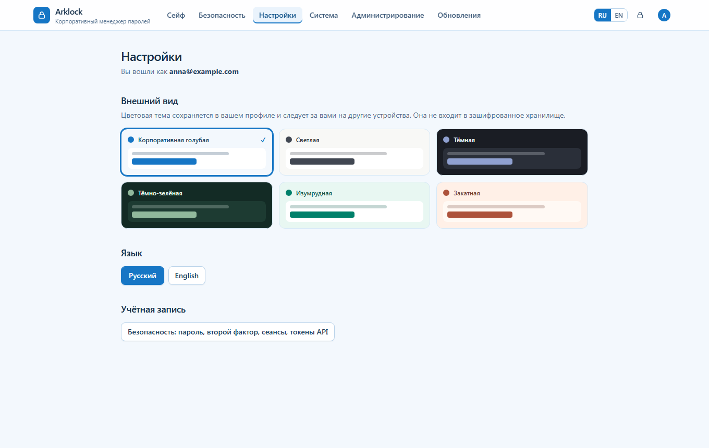
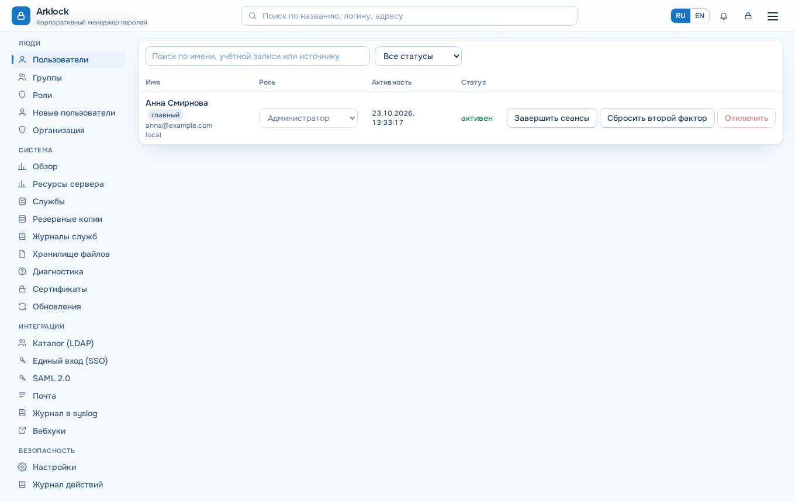

# Arklock

**Корпоративный менеджер паролей на вашем сервере.** Пароли, заметки и ключи API доступны сотрудникам по назначенным правам. Шифрование происходит в браузере: сервер хранит шифртекст. Рабочие записи по умолчанию создаются в корпоративном сейфе; личное пространство разрешает администратор.


## Что умеет

- **Корпоративные пространства и сейфы, управляемое личное пространство.** Пространства объединяют сейфы и назначаются сотрудникам или группам. В сейфах есть папки, поиск, избранное, архив, корзина и возврат прежней версии. Личные сейфы выключены по умолчанию; разрешения выдаются организации, группам или отдельным сотрудникам.
- **Доступ по пользователям и группам.** Прямые и наследуемые права на сейфы, папки и записи, явные запреты и сроки действия. Состояние выдачи ключа видно во вкладке «Доступ».
- **Полная карточка записи.** Данные, файлы и TOTP, управление доступом, журнал действий и наследуемые требования к паролям.
- **Генератор паролей и парольных фраз** прямо в форме записи, с настройками длины и символов.
- **Вход и защита.** Двухфакторная аутентификация (TOTP и ключи безопасности), вход через Active Directory / LDAP, OpenID Connect и SAML.
- **Корпоративное восстановление.** Заранее подключённые сейфы можно открыть с зашифрованным офлайн-пакетом и его парольной фразой. Действие доступно полному администратору и записывается в журнал.
- **Уведомления и почта.** Центр событий в шапке показывает изменения доступа и предупреждения безопасности; сообщения можно читать, архивировать и настраивать по категориям. Администратор управляет SMTP-профилями и видит состояние отправки писем.
- **Проверка паролей.** Инспектор находит слабые, повторяющиеся и скомпрометированные пароли.
- **Импорт и экспорт.** CSV, JSON, KeePass XML, Bitwarden и Passwork, зашифрованная выгрузка.
- **Администрирование без командной строки.** Пользователи с именем или почтой для входа, группы, роли, LDAP, SSO, почта, журналы, обновления и резервные копии — в веб-интерфейсе.
- **Шесть тем оформления**, адаптивный интерфейс для компьютера, планшета и телефона. Установка приложения на телефон (PWA) и расширение для браузера.



| Администрирование | Телефон |
| --- | --- |
|  |  |

| Доступ к записи | Корпоративное восстановление |
| --- | --- |
|  |  |

## Установка

Нужен сервер с **Ubuntu 22.04 или 24.04 LTS** либо **Debian 12**, 1 ГБ памяти и доступ root. Docker установщик поставит сам.

```bash
curl -fsSL https://github.com/calleograph/Arklock/releases/latest/download/install.sh | sudo bash
```

Установщик спросит, откуда будут открывать Arklock: только с этого сервера, из локальной сети или через внешний reverse proxy. В конце он выведет адрес и одноразовый код настройки.

Потом:

1. Откройте адрес и создайте первую учётную запись — она станет администратором.
2. Введите код настройки из вывода установщика.
3. **Сохраните личный ключ восстановления.** Для корпоративных сейфов отдельно настройте офлайн-пакет организации и явно подключите каждый сейф. Без заранее сохранённых ключей восстановление невозможно.
4. Добавьте сотрудников и назначьте доступ к корпоративному сейфу. Для важных данных подготовьте двух независимых хранителей с ключами — их состояние видно в обзоре администратора.

Чтобы открыть Arklock с других компьютеров, браузер требует HTTPS. Подробности, режимы HTTPS и профиль для сервера с другими приложениями — в [инструкции по установке](docs/INSTALL.md). Если что-то пошло не так, начните с [устранения неполадок](docs/TROUBLESHOOTING.md).

## Обслуживание

```bash
sudo scripts/status.sh      # состояние
sudo scripts/backup.sh      # зашифрованная резервная копия
sudo scripts/check-updates.sh
sudo scripts/update.sh      # обновление с копией и автоматическим откатом
sudo scripts/diag.sh        # диагностический пакет без секретов
```

Обновить можно и из веб-интерфейса: раздел «Обновления».

## Безопасность

Мастер-пароль и ключи создаются и используются только в браузере. Из пароля выводятся независимые ключи для шифрования и для входа; каждая запись шифруется отдельным ключом. Резервные копии шифруются ключом, который хранится отдельно от них.

Права отдельных объектов проверяет сервер. Общий ключ сейфа пока не обеспечивает криптографической изоляции отдельных записей от участника, сохранившего этот ключ и шифртекст. Для независимых границ доступа создавайте отдельные сейфы. Возможности и ограничения корпоративного восстановления — в [руководстве администратора](docs/administration/corporate-access.md).

**Криптография Arklock не проходила независимый аудит.** Описание схемы — в [документации по криптографии](docs/security/cryptography.md), материалы для проверки — в [пакете для аудита](docs/security/audit-package.md). Модель отзыва доступа описана в [документе о выдаче и отзыве доступа](docs/security/access-revocation.md): отзыв на сервере действует сразу, но уже скопированные секреты отозвать нельзя.

Об уязвимостях сообщайте по инструкции в [SECURITY.md](SECURITY.md).

## Документация

- [Установка](docs/INSTALL.md) и [устранение неполадок](docs/TROUBLESHOOTING.md)
- [Обновление](docs/UPDATE.md), [резервные копии](docs/BACKUP_AND_RESTORE.md)
- [Администрирование и роли](docs/administration/README.md), [каталог и SSO](docs/DIRECTORY.md), [SAML](docs/SAML.md)
- [Браузерное расширение и телефон](docs/EXTENSION.md), [командная строка и токены](docs/CLI.md)
- [Архитектура](docs/architecture/overview.md), [API](docs/api/README.md), [разработка](CONTRIBUTING.md)

История изменений — в [CHANGELOG.md](CHANGELOG.md).

## Для разработчиков

Node.js 24+. `npm ci && npm run build`. Проверки: `npm run format:check && npm run lint && npm run typecheck && npm test`; браузерные тесты: `npx playwright install chromium && npm run test:e2e`. Снимки экранов для этой страницы: `node scripts/screenshots.mjs docs/screenshots`.

## Лицензия

Arklock распространяется по **GNU AGPL v3.0 only** (SPDX: `AGPL-3.0-only`), текст — в [LICENSE](LICENSE). Сторонние компоненты — в [NOTICE](NOTICE) и [THIRD-PARTY-NOTICES.md](THIRD-PARTY-NOTICES.md). Продукт бесплатный, без платных редакций и лицензионных ключей.
