<p align="center">
  
</p>

<h1 align="center">Arklock</h1>

<p align="center">
  <b>Корпоративный менеджер паролей, который вы размещаете у себя.</b><br>
  Шифрование в браузере сотрудника · права по людям и группам · администрирование без командной строки
</p>

<p align="center">
  <a href="https://github.com/calleograph/Arklock/releases/latest"></a>
  <a href="https://github.com/calleograph/Arklock/actions/workflows/ci.yml"></a>
  <a href="LICENSE"></a>
</p>

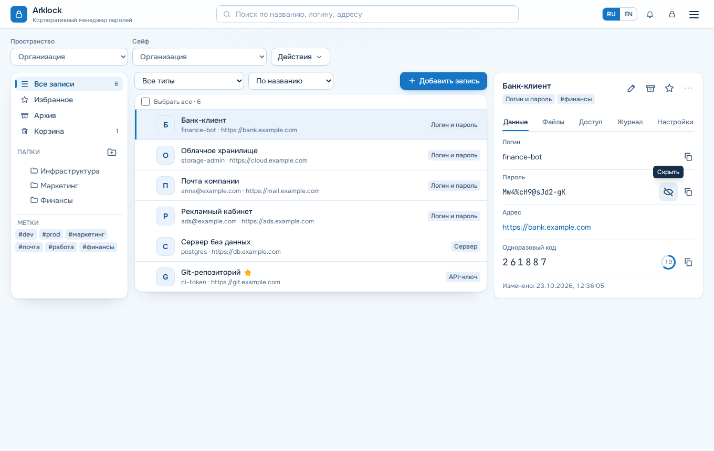

## Что это простыми словами

Пароли компании часто живут в чатах, таблицах и записных книжках. Уволился сотрудник — и никто не знает, какие доступы он унёс. Пришёл новый — и ему неделю собирают пароли по крупицам.

**Arklock — общая защищённая «связка ключей» для всей команды, которая стоит на вашем сервере, а не в чужом облаке.**

- **Пароли видите только вы.** Записи шифруются в браузере сотрудника. На сервер попадает «шифрованная каша», и даже администратор сервера не может её прочитать.
- **Каждый видит своё.** Бухгалтерия — пароли бухгалтерии, ИТ — серверы, руководство — свой закрытый сейф. Доступ выдаётся людям и целым отделам.
- **Новый сотрудник — за минуты.** Пригласили, выбрали отдел — доступ к нужным паролям есть.
- **Уволили одним действием.** Arklock закроет доступ, завершит сеансы и покажет список паролей, которые теперь нужно сменить.
- **Всё настраивается мышкой.** Установка, обновления, резервные копии и почта — в веб-панели, без командной строки.
- **Бесплатно и открыто.** Без платных тарифов, лицензионных ключей и телеметрии (AGPL-3.0).

### Как это выглядит в компании

1. Вы ставите Arklock одной командой (ниже) и открываете панель «Начало работы»: шесть понятных шагов от адреса сервера до резервной копии.
2. Мастер **«Подразделения»** создаёт отдел целиком за один проход: группу, закрытое пространство, сейф отдела, отдельный сейф руководства и стартовые папки. Можно вставить список из двадцати отделов сразу.
3. **«Пригласить списком»**: вставляете «Имя; почта; отдел» на каждую строку и получаете коды активации и файл CSV.
4. Сотрудник переходит в другой отдел — Arklock заранее показывает, какой доступ он потеряет и какой получит.
5. Обзор безопасности выстраивает подразделения по уровню риска: видно, где слабые и повторяющиеся пароли.

Проверено на учебной организации: 20 подразделений, 60+ сотрудников, сейф на 1500 записей. Создание отдела заняло 6 действий вместо 34, список из 12 сотрудников — 6 действий вместо 84. Подробности и замеры — в [отчёте о проверке внедрения](docs/UX_ENTERPRISE_JOURNEY_AUDIT.md).

### Для кого

Для компании от 5 до нескольких сотен человек, которой нужен свой менеджер паролей: ИТ-отделы, небольшие и средние организации, команды разработки. Если есть Active Directory или LDAP, сотрудники входят с ним же.

## Установка за пять минут

Нужен сервер с **Ubuntu 22.04 / 24.04 LTS** или **Debian 12**, 1 ГБ памяти и доступ root. Docker установщик поставит сам и не тронет другие контейнеры на сервере.

```bash
curl -fsSL https://github.com/calleograph/Arklock/releases/latest/download/install.sh | sudo bash
```

Установщик спросит, откуда открывать Arklock: только с этого сервера, из локальной сети или через внешний reverse proxy. В конце он покажет адрес и одноразовый код настройки.

1. Откройте адрес и создайте первую учётную запись: она станет администратором.
2. **Сохраните ключ восстановления.** Без него забытый мастер-пароль не восстановить: сервер его не знает.
3. Добавьте сотрудников вручную, приглашением или через LDAP и назначьте доступ к корпоративным сейфам.

Для доступа с других компьютеров браузеру нужен HTTPS. Режимы HTTPS и работа рядом с другими приложениями описаны в [инструкции по установке](docs/INSTALL.md).

<p align="center">
  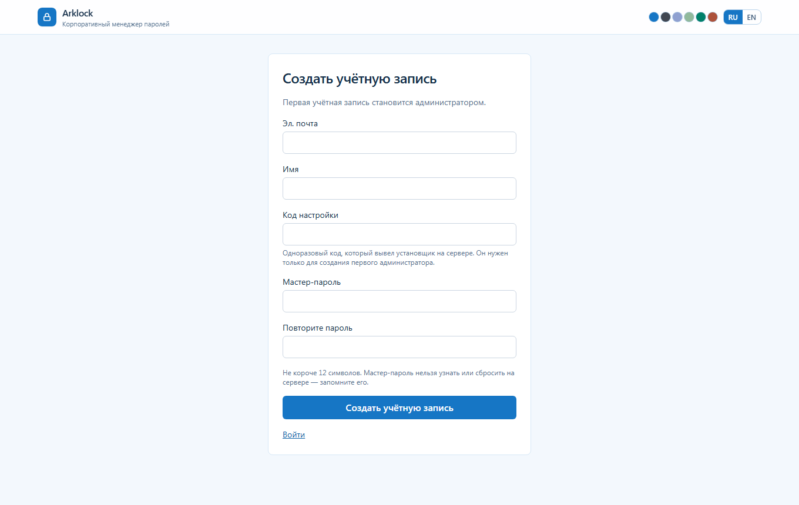
  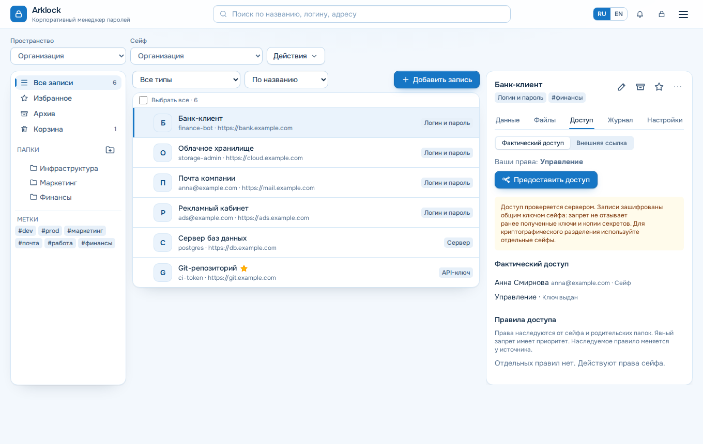
</p>

## Что внутри

**Для сотрудников**

- **Сейфы, вложенные папки, метки, избранные записи и папки, архив и корзина.** Поиск по всем доступным сейфам, история версий записи, значки и цвета папок и записей (зашифрованы вместе с данными), меню по правой кнопке.
- **Карточка записи.** Логин, пароль, адрес, одноразовые коды TOTP с кольцом оставшегося времени, файлы, дополнительные поля (строка, многострочный текст, пароль, код TOTP; порядок меняется) и связанные записи. Копирование в одно нажатие с автоочисткой буфера.
- **Генератор паролей и парольных фраз**, проверка требований организации прямо при сохранении.
- **Передача секрета по ссылке** с ограничением срока, числа просмотров и окна после первого открытия; ограничения и примечание для получателя задаёт организация.
- **Быстрая разблокировка PIN-кодом** на доверенном устройстве, если её разрешил администратор.
- **Расширение для Chromium и Firefox**, установка на телефон (PWA), командная строка и токены API.

**Для администратора**

- **Пространства и корпоративные сейфы.** Личные сейфы выключены по умолчанию и разрешаются организации, группам или отдельным людям.
- **Права на сейф, папку и запись** с наследованием, сроками и явным запретом. Вкладка «Доступ» показывает итоговое право, его источник и готовность ключа.
- **Роли и делегирование.** Главный администратор назначает полных администраторов и передаёт роль только с подтверждением преемника. Административные роли назначаются людям и группам, в том числе сопоставленным с группами AD. Роль не открывает содержимое сейфов.
- **Подразделения и карточки сотрудников.** Закрытые пространства подразделений без утечки метаданных между ними, обзор организации для главного администратора, карточка сотрудника с данными из AD/LDAP.
- **Вход:** двухфакторная аутентификация (TOTP, ключи безопасности), несколько каталогов LDAP / Active Directory с плановой сверкой, OpenID Connect и SAML 2.0.
- **Увольнение сотрудника одним действием.** Передача владения, блокировка, отзыв прав, сеансов и токенов, список сейфов, где нужно сменить ключ.
- **Корпоративное восстановление** через зашифрованный офлайн-пакет для заранее подключённых сейфов, с журналом и безопасной заменой пакета.
- **Инспектор безопасности.** Слабые, повторяющиеся и устаревшие пароли, проверка утечек по k-anonymity через один или несколько сервисов. Каждый показатель сводки сейфа открывает список проблемных записей.
- **Журнал действий** с поиском по сотруднику и IP, сортировкой по времени и действию, журнал сотрудника в его карточке: вход, открытие карточки, показ и копирование секрета, изменения; отправка в syslog и подписанные вебхуки.
- **Эксплуатация в браузере.** Обзор ресурсов, службы и журналы, резервные копии (в том числе на S3 и SMB) с пробным восстановлением во временную базу, обновления с откатом и списком фактических версий компонентов, SBOM к каждому выпуску, сертификаты, SMTP-профили, публичный адрес без перезапуска, диагностика со ссылками на нужную настройку.
- **Импорт и экспорт** в отдельном разделе меню: CSV (заголовки определяются сами), JSON, KeePass XML, Bitwarden, Passwork; выгрузка одного сейфа, пространства или всего доступного в JSON, CSV или зашифрованный архив с автоматически созданным паролем из 30 знаков. Подробнее — [инструкция](docs/IMPORT_EXPORT.md).

| Администрирование | Корпоративное восстановление |
| --- | --- |
| 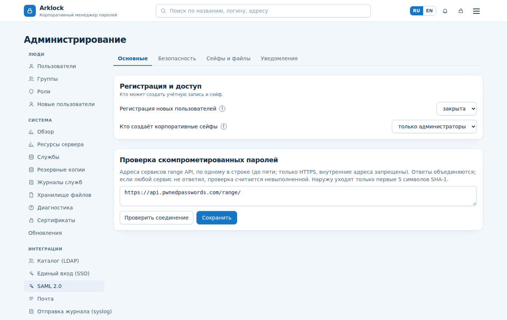 | 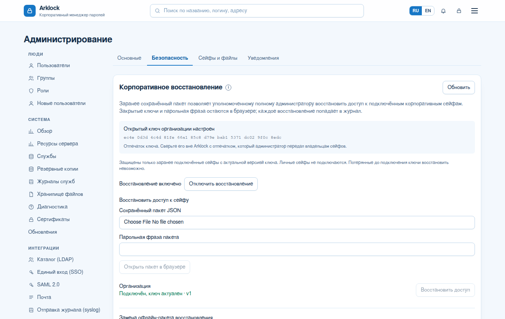 |

## Шесть тем и телефон

Одна система оформления в шести палитрах: корпоративная голубая, светлая, тёмная, тёмно-зелёная, изумрудная и закатная. Тема хранится в профиле и следует за сотрудником на другие устройства. На телефоне те же возможности, что и на компьютере.

<p align="center">
  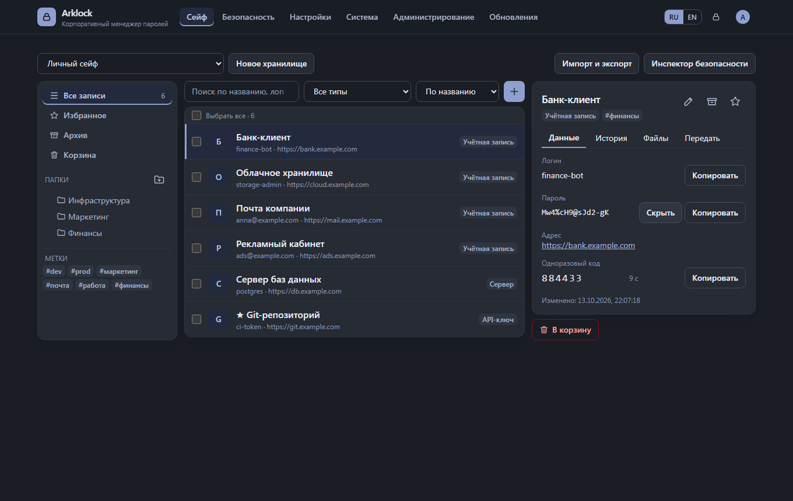
  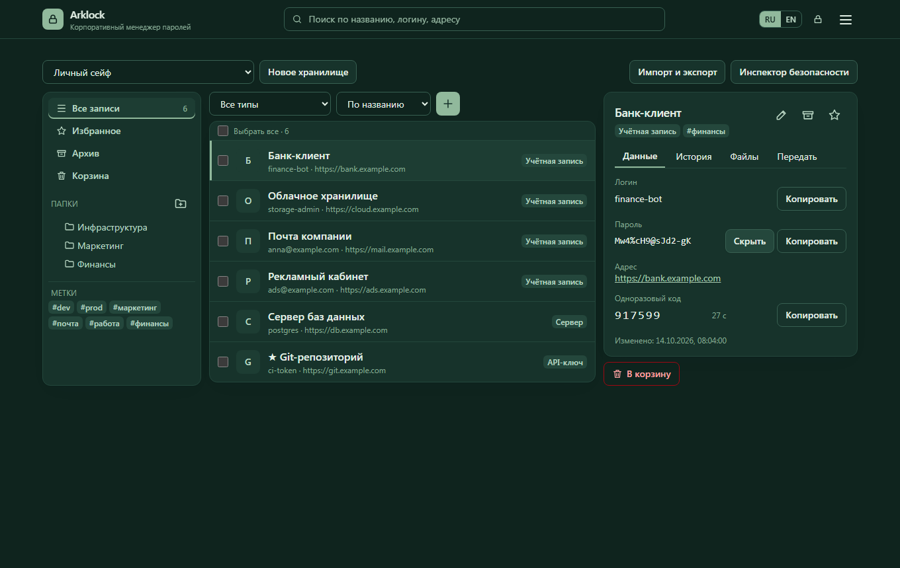
  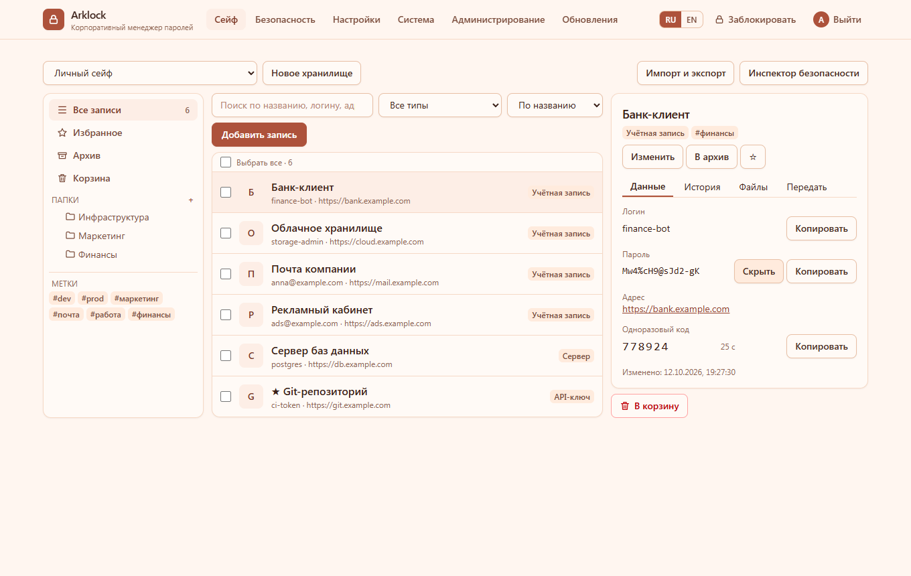
</p>

<p align="center">
  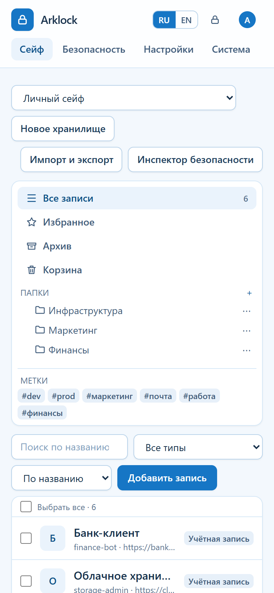
  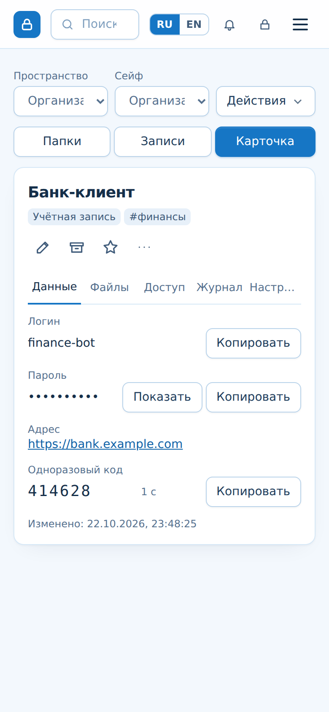
  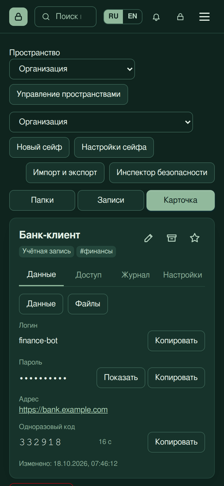
</p>

## Модель защиты

| Что | Как устроено |
| --- | --- |
| Мастер-пароль | Не покидает браузер. Из него через Argon2id выводятся независимые ключи для входа и для шифрования. |
| Записи | Каждая запись шифруется своим ключом (AES-256-GCM), ключ записи — ключом сейфа, ключ сейфа — ключом каждого участника. |
| Сервер | Хранит шифртекст, проверяет права и сеансы. Открыть записи не может. |
| Отзыв доступа | Действует на сервере сразу. Уже скопированные человеком секреты отозвать нельзя, поэтому после увольнения нужно сменить ключ сейфа и пароли. |
| Изоляция записи | Сервер не отдаёт запрещённые записи, но участник с ключом сейфа технически может расшифровать любую запись этого сейфа. Для независимых границ доверия используйте разные сейфы. |
| Резервные копии | Шифруются ключом, который хранится отдельно от копий. |

**Криптография Arklock не проходила независимый аудит.** Схема описана в [документации по криптографии](docs/security/cryptography.md), материалы для проверки собраны в [пакете для аудита](docs/security/audit-package.md). Об уязвимостях сообщайте по [SECURITY.md](SECURITY.md).

Что реализовано полностью, что частично, а что упирается в архитектуру, — в честной [таблице состояния функций](docs/FEATURE_STATUS.md).

## Обслуживание

```bash
sudo scripts/status.sh         # состояние
sudo scripts/backup.sh         # зашифрованная резервная копия
sudo scripts/check-updates.sh  # есть ли новая версия
sudo scripts/update.sh         # обновление с копией и автоматическим откатом
sudo scripts/diag.sh           # диагностический пакет без секретов
```

То же доступно в веб-панели: «Администрирование → Обновления» и «Резервные копии».

## Документация

- **Запуск:** [установка](docs/INSTALL.md), [обновление](docs/UPDATE.md), [резервные копии и восстановление](docs/BACKUP_AND_RESTORE.md), [устранение неполадок](docs/TROUBLESHOOTING.md)
- **Администрирование:** [роли и разделы](docs/administration/README.md), [корпоративный доступ, увольнение и восстановление](docs/administration/corporate-access.md), [LDAP и SSO](docs/DIRECTORY.md), [SAML](docs/SAML.md), [вебхуки](docs/administration/webhooks.md)
- **Безопасность:** [криптография](docs/security/cryptography.md), [выдача и отзыв доступа](docs/security/access-revocation.md), [PIN-разблокировка](docs/security/pin-unlock.md), [формат зашифрованного архива](docs/security/export-format.md)
- **Клиенты:** [расширение браузера и телефон](docs/EXTENSION.md), [командная строка и токены](docs/CLI.md), [API](docs/api/README.md), [импорт и экспорт](docs/IMPORT_EXPORT.md)
- **Разработка:** [архитектура](docs/architecture/overview.md), [как участвовать](CONTRIBUTING.md), [история изменений](CHANGELOG.md)

## Для разработчиков

Node.js 24+, TypeScript, Fastify и PostgreSQL на сервере, Vue 3 и Tailwind в браузере.

```bash
npm ci && npm run build
npm run format:check && npm run lint && npm run typecheck && npm test
npx playwright install chromium && npm run test:e2e   # браузерные сценарии
node scripts/screenshots.mjs docs/screenshots         # снимки для этой страницы
```

## Лицензия

**GNU AGPL v3.0 only** (`AGPL-3.0-only`), текст в [LICENSE](LICENSE). Сторонние компоненты перечислены в [NOTICE](NOTICE) и [THIRD-PARTY-NOTICES.md](THIRD-PARTY-NOTICES.md); шрифты Onest и JetBrains Mono распространяются по SIL Open Font License 1.1. Продукт бесплатный: без платных редакций, лицензионных ключей и телеметрии.
