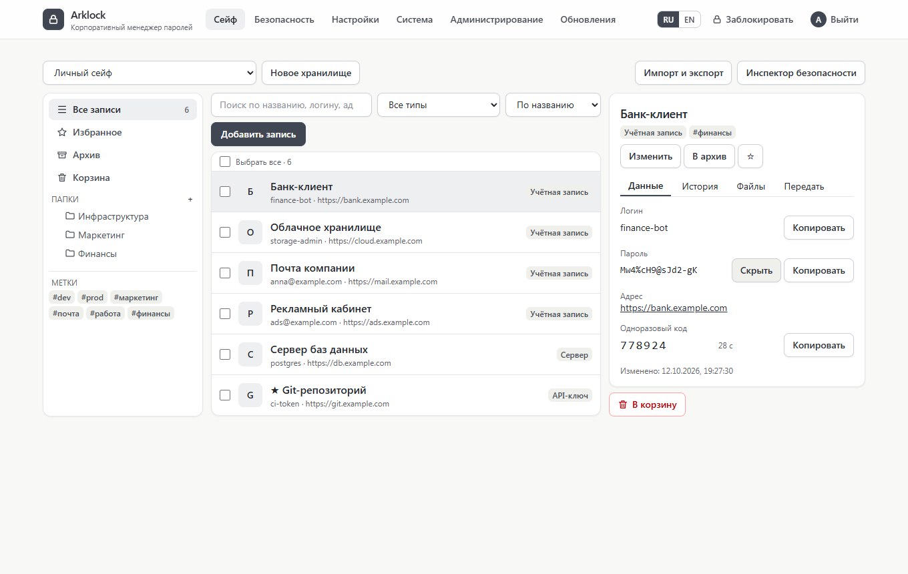
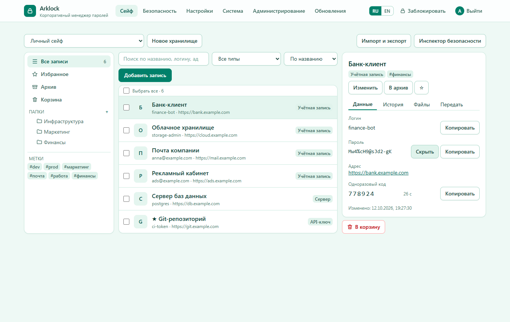
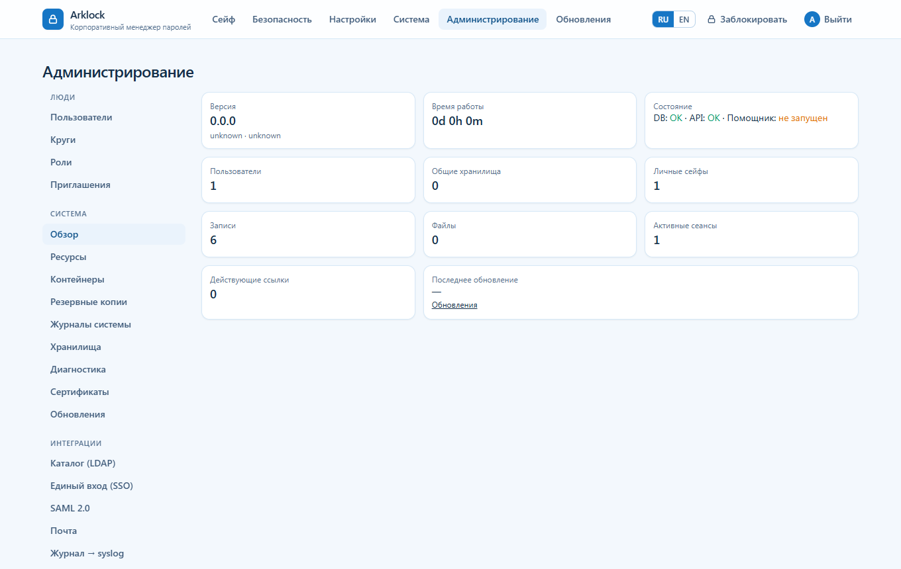

# Arklock

**Arklock — менеджер паролей для команд и организаций с открытым исходным кодом.** Устанавливается на ваш сервер одной командой, шифрует данные на стороне клиента (сервер хранит только шифртекст), имеет полноценную панель администратора и шесть цветовых тем оформления. Бесплатный, без платных редакций и ограничений.


> **Криптография Arklock не проходила независимый аудит и сертификацию.** Архитектура описана в [docs/security/cryptography.md](docs/security/cryptography.md), материалы для проверки — в [docs/security/audit-package.md](docs/security/audit-package.md). Оцените риски сами, прежде чем доверять продукту критичные секреты.

## Возможности

**Хранение и работа с записями**

- Записи разных типов (учётные данные, серверы, ключи API, заметки), пользовательские поля, теги, избранное, архив и корзина с восстановлением, история изменений с возвратом версии.
- Папки любой вложенности, групповые операции, быстрый поиск и фильтры, копирование логина и пароля одним нажатием, одноразовые коды TOTP.
- Вложения: файлы шифруются в браузере, любой размер (шифрование и загрузка по частям).
- Генератор паролей и парольных фраз, оценка стойкости, инспектор безопасности (слабые, повторяющиеся, старые, скомпрометированные пароли — без передачи паролей на сервер).
- Импорт (CSV, Bitwarden, KeePass) и экспорт (CSV, JSON, зашифрованный).
- Ссылки для передачи секрета: временные и одноразовые, ключ только во фрагменте адреса.

**Командная работа и доступ**

- Личный сейф и общие хранилища; роли (владелец, администратор, редактор, читатель, ограниченный), круги, права на папки и записи с наследованием, сроком действия и отзывом; ротация ключа после отзыва доступа.
- Пользовательские роли и делегированное администрирование, приглашения по ссылке.
- Вход через LDAP / Active Directory, OpenID Connect и SAML 2.0.
- Второй фактор: TOTP, резервные коды, ключи доступа (WebAuthn); политика обязательного MFA; политика паролей организации.

**Администрирование**

- Панель администратора: пользователи, круги, роли, приглашения, настройки, журнал событий, состояние сервера, контейнеры, диагностика, сертификаты, почта, каталог, SSO, экспорт журнала в syslog.
- Шифрованные резервные копии с расписанием, проверкой, скачиванием и восстановлением; удалённые хранилища копий (S3 и SMB).
- Обновление приложения и откат из веб-интерфейса (с копией перед обновлением и автоматическим восстановлением при сбое).
- Автоматическая настройка HTTPS и Nginx (Let's Encrypt, самоподписанный или собственный сертификат).

**Платформы**

- Веб-приложение с адаптивной вёрсткой (компьютер, планшет, телефон), установка как PWA.
- Расширение для браузера (Manifest V3): поиск по адресу страницы, заполнение форм, TOTP, генератор. Chrome/Chromium — проверено автотестами; Firefox — сборка и установка проверены, основные действия нужно проверить вручную (см. [docs/EXTENSION.md](docs/EXTENSION.md)).
- Консольный клиент `arklock` и токены API.

## Шесть тем оформления

Тема выбирается в **Настройки → Внешний вид**, применяется мгновенно ко всему приложению (вход, рабочая область, панель администратора, окна и меню) и хранится в профиле пользователя — следует за вами на другие устройства. По умолчанию используется «Корпоративная голубая». Тема не входит в зашифрованное хранилище.

| Корпоративная голубая                                        | Светлая                                        | Тёмная                                       |
| ------------------------------------------------------------ | ---------------------------------------------- | -------------------------------------------- |
|  |    |    |

| Тёмно-зелёная                                  | Изумрудная                                       | Закатная                                       |
| ---------------------------------------------- | ------------------------------------------------ | ---------------------------------------------- |
|  |  |  |

## Скриншоты

| Вход                                           | Настройки пользователя                              |
| ---------------------------------------------- | --------------------------------------------------- |
|   |  |

| Панель администратора: обзор                            | Панель администратора: пользователи                    |
| ------------------------------------------------------- | ------------------------------------------------------ |
|  |  |

| Телефон: список                                       | Телефон: запись                                       | Телефон: тёмно-зелёная тема                         |
| ----------------------------------------------------- | ----------------------------------------------------- | --------------------------------------------------- |
|  |  |  |

## Установка

Требуется сервер с Ubuntu 24.04 LTS или Debian 12 (1 ГБ памяти, доступ root). Одна команда:

```bash
curl -fsSL https://github.com/calleograph/arklock/releases/latest/download/install.sh | sudo bash
```

Установщик проверяет систему, при необходимости ставит Docker, создаёт секреты (в `/etc/arklock`, права 600), запускает приложение и PostgreSQL, проверяет установку и выводит адрес и одноразовый код первой настройки. Если предпочитаете сначала прочитать установщик: скачайте `install.sh` со [страницы релиза](https://github.com/calleograph/arklock/releases/latest), сверьте с `SHA256SUMS` и запустите `sudo bash install.sh`.

После установки откройте адрес из итога, создайте первую учётную запись (она станет администратором), введите код настройки и **сохраните ключ восстановления** — без него и мастер-пароля данные недоступны. Подробности, HTTPS, профиль shared-host (сервер с другими приложениями) — [docs/INSTALL.md](docs/INSTALL.md).

Образ приложения публикуется в GHCR: `ghcr.io/calleograph/arklock:<версия>` (linux/amd64, linux/arm64). Установщик и обновление используют его, если он соответствует выбранному релизу, а при недоступности собирают образ из исходного кода.

## Обслуживание

```bash
sudo scripts/status.sh              # состояние
sudo scripts/backup.sh              # зашифрованная резервная копия
sudo scripts/restore.sh ФАЙЛ        # восстановление
sudo scripts/check-updates.sh       # есть ли новая версия
sudo scripts/update.sh              # обновление (с копией перед обновлением и автоматическим восстановлением)
sudo scripts/rollback.sh            # откат (отказывает, если схема БД изменилась)
sudo scripts/diag.sh                # диагностический пакет без секретов
```

Те же действия доступны администратору в веб-интерфейсе (**Администрирование**, **Обновления**).

Документация: [установка](docs/INSTALL.md) · [обновление](docs/UPDATE.md) · [резервное копирование](docs/BACKUP_AND_RESTORE.md) · [диагностика](docs/DIAGNOSTICS.md) · [командная строка и токены](docs/CLI.md) · [каталог и SSO](docs/DIRECTORY.md) · [SAML](docs/SAML.md) · [администрирование и роли](docs/administration/README.md) · [расширение и телефон](docs/EXTENSION.md) · [криптография](docs/security/cryptography.md) · [модель угроз](docs/security/threat-model.md) · [API](docs/api/README.md) · [архитектура](docs/architecture/overview.md)

## Безопасность

Мастер-пароль и ключи никогда не покидают браузер: из пароля Argon2id выводятся независимые ключи шифрования и входа; закрытый ключ аккаунта хранится на сервере только в зашифрованном виде; каждая запись шифруется собственным ключом, привязанным к контексту (AAD). Резервные копии дополнительно шифруются ключом, который хранится отдельно от копий. Об уязвимостях сообщайте согласно [SECURITY.md](SECURITY.md).

## Разработка

Node.js 24+. `npm ci && npm run build`; проверки: `npm run format:check && npm run lint && npm run typecheck && npm test`; тесты в браузере: `npx playwright install chromium && npm run test:e2e`. Снимки экранов: `node scripts/screenshots.mjs`. См. [CONTRIBUTING.md](CONTRIBUTING.md). Изменения — [CHANGELOG.md](CHANGELOG.md).

## Известные ограничения версии 1.0

- Независимого аудита криптографии не было (см. выше).
- Автоматически проверены Ubuntu 24.04 и Debian 12 на раннерах CI; на других системах, на «железных» серверах и при нехватке места установка не проверялась.
- Выпуск сертификатов Let's Encrypt в CI не проверялся (проверены самоподписанный и собственный сертификаты).
- LDAP проверен на тестовом каталоге, SSO и SAML — на тестовых провайдерах; промышленные OpenLDAP, Active Directory и провайдеры удостоверений не проверялись.
- Расширение не опубликовано в магазинах; основные сценарии в Firefox проверены частично (установка и форма входа), остальное — вручную.
- Нет нативных мобильных приложений (есть PWA).

## Лицензия

Arklock распространяется на условиях **GNU Affero General Public License v3.0 only** (SPDX: `AGPL-3.0-only`), текст — в файле [LICENSE](LICENSE); уведомления об авторских правах и материалы третьих сторон — [NOTICE](NOTICE) и [THIRD-PARTY-NOTICES.md](THIRD-PARTY-NOTICES.md). AGPL требует, чтобы изменённая версия, доступная пользователям по сети, предоставляла им исходный код этой версии; коммерческое использование и оказание услуг лицензией не запрещены.
