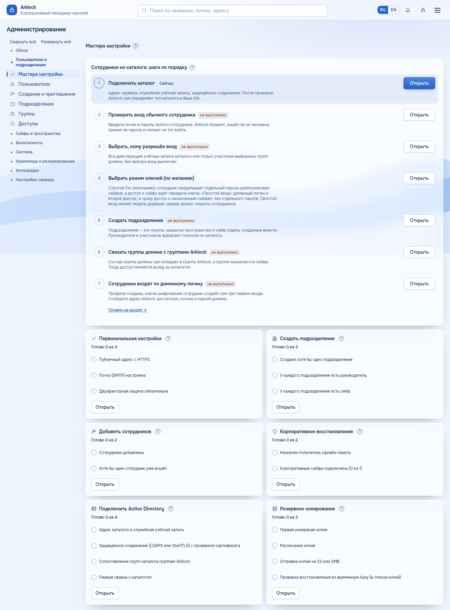
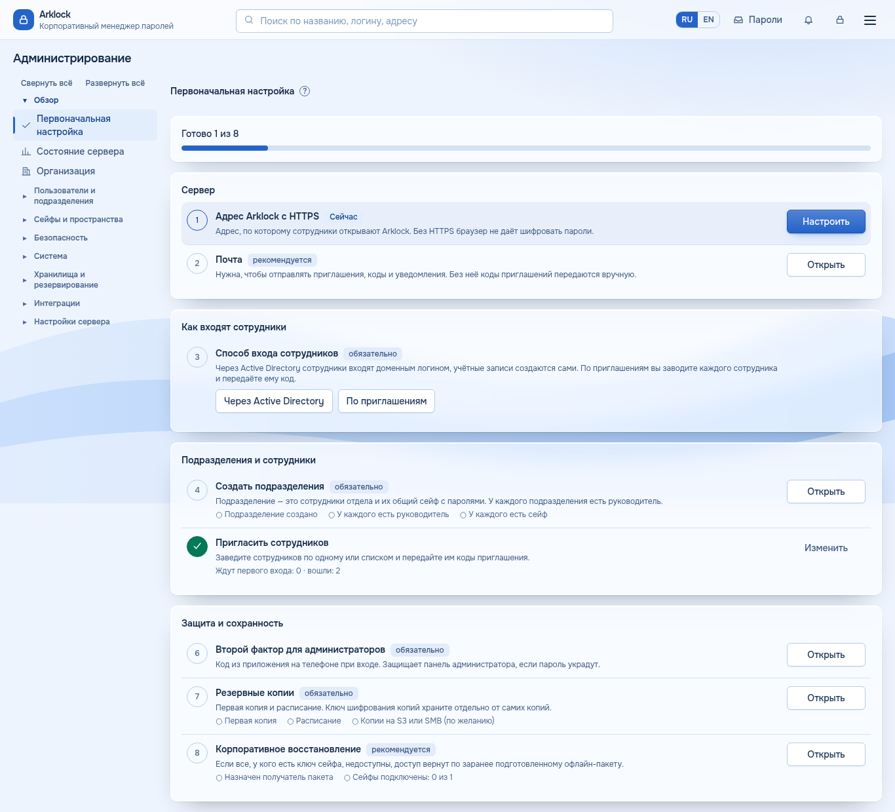
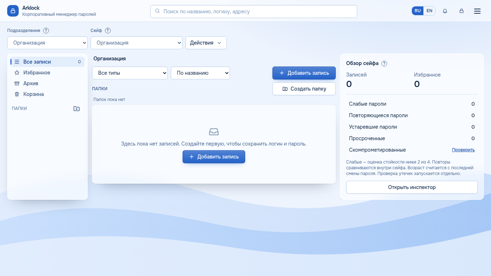
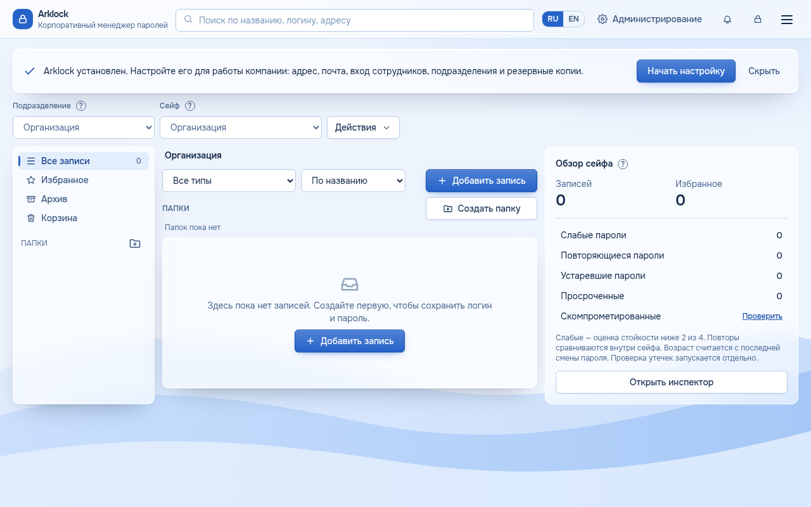
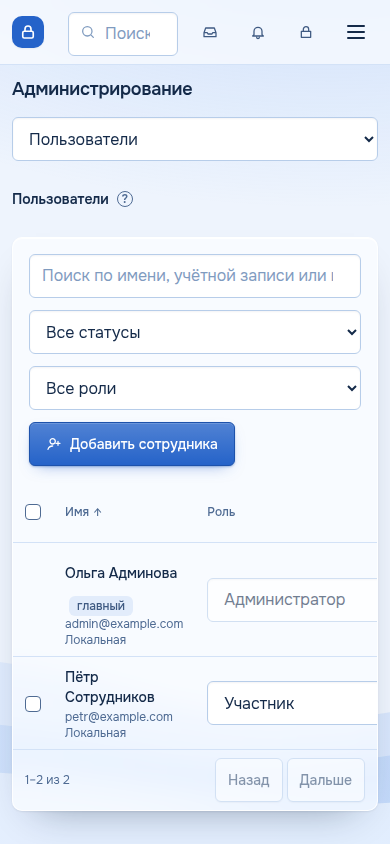
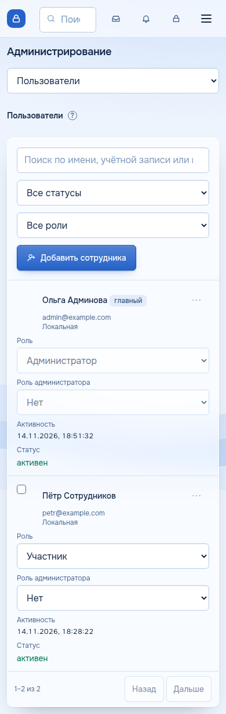
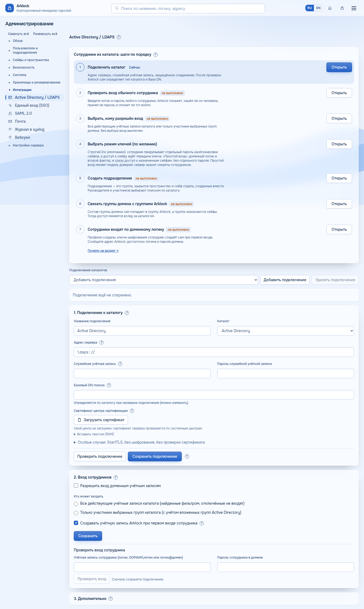
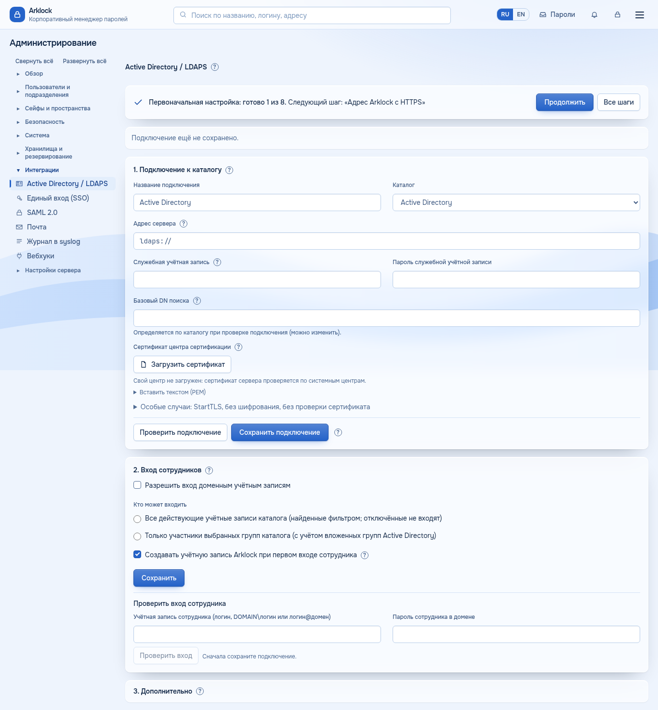
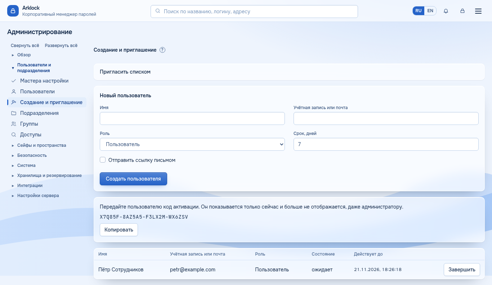
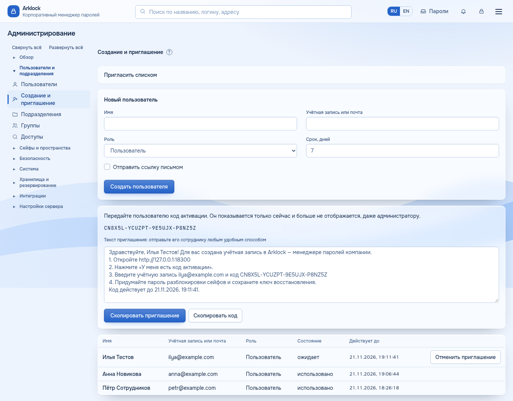

# Комплексный аудит продукта: первая настройка, повседневная работа, дизайн-система (1.98.0)

Предыдущие аудиты: [внедрение в компании](UX_ENTERPRISE_JOURNEY_AUDIT.md), [повседневная работа](UX_FULL_AUDIT.md), [формы](UX_FORMS_AUDIT.md), [проводник сейфа](UX_FOLDER_EXPLORER_AUDIT.md). Этот проход оценивает продукт целиком глазами трёх людей и исправляет то, что мешает им выполнить задачу самостоятельно. Повторно проверялось только то, что менялось после прошлых аудитов или выглядело проблемой при живом проходе.

## 1. Как проверялось

- Чистая установка (пустая база, вымышленные данные `example.com`), настоящий браузер (agent-browser, Chromium), без тестовых обходов: новый администратор с первого экрана, сотрудник по приглашению, администратор в повседневных задачах.
- Ширины 1920, 1366, 1280, 1024, 768, 390 и 360 px: `scripts/ui-audit.mjs --layout` (все разделы, 231 экран) и `scripts/ui-audit-directory.mjs --tabs` (экраны с данными и каталогом).
- Действие — одно нажатие, ввод в поле или выбор в списке. Переход — смена страницы или раздела.
- Оценки — наблюдения автора, опроса пользователей не было.

## 2. Главная проблема

Возможностей много, но человеку приходилось самому собирать из них последовательность. Подсказки о настройке были в трёх местах, и они противоречили друг другу по составу и порядку: шесть пунктов «Начало работы» на обзоре, семь шагов каталога на странице мастеров и в разделе каталога, и ещё шесть карточек мастеров со своими списками. HTTPS, почта, подразделения, сотрудники и копии повторялись в двух-трёх местах, а общего порядка не было. После создания главного администратора человек попадал в пустой сейф без единой подсказки, а вход в администрирование был спрятан в меню «≡».

## 3. Сценарии: было → стало

| Сценарий | Было | Стало |
| --- | --- | --- |
| Новый администратор после ключа восстановления: понять, что настраивать | Пустой сейф, подсказок нет. Нужно найти «≡» → «Администрирование» (2 действия) → список из 6 пунктов без каталога и способа входа. Шаги каталога — в другом разделе (ещё 2 действия), третий список — в мастерах | Полоса «Arklock установлен… — Начать настройку» сразу на экране → 1 действие → один список по порядку с отметкой «Сейчас» |
| Перейти в администрирование и обратно | 2 действия (меню «≡» → пункт), обратно — тоже через меню | 1 кнопка в шапке в обе стороны |
| Добавить сотрудника из списка пользователей | В списке нет кнопки: нужно знать отдельный пункт меню «Создание и приглашение» | «Добавить сотрудника» в списке — 1 действие |
| Передать сотруднику приглашение | Показывается только код; что с ним делать, администратор объясняет сам | Готовый текст (адрес, что нажать, учётная запись, код, срок) и «Скопировать приглашение» — 1 действие |
| Сотрудник вошёл, а доступа к сейфам ещё нет | Пустой экран: «Подразделение: Организация» и пустой список «Сейф», ни слова о том, что делать | «У вас пока нет доступа к сейфам»: кто выдаёт доступ, что будет дальше; сейф появляется сам (проверка раз в 20 с и при возврате на вкладку) или по «Проверить сейчас» |
| Выдать доступ к сейфу | «Действия» → «Настройки сейфа» → прокрутить мимо политики паролей и восстановления → «Предоставить доступ» | Те же 3 действия, участники и группы — первыми, без прокрутки |
| Подключить Active Directory впервые | Над формой — 7 шагов на 900 px; строка с двумя «Добавить подключение» и неактивным «Удалить» над пустой формой | Полоса «следующий шаг», форма сразу под ней; выбор подключения появляется, когда есть что выбирать |
| Читатель открыл пустой сейф | «Создайте первую запись» (читатель создать не может) | «В этом сейфе пока нет записей» |

## 4. Найденные проблемы и исправления

| № | Приоритет | Проблема | Исправление | Проверка |
| --- | --- | --- | --- | --- |
| 1 | P1 | Сотрудник без доступа к сейфам видел пустой экран | Экран «нет доступа» с объяснением, автообновлением и «Проверить сейчас» | `admin-panel.spec.ts` (приглашённый сотрудник без личного сейфа); живой проход |
| 2 | P2 | Три противоречивых списка настройки, нет общего порядка | Один список `services/setup.ts` → страница «Первоначальная настройка» и полоса «следующий шаг»; старые списки удалены | `setup.test.ts` (ветки «каталог» и «приглашения», текущий шаг), `enterprise.spec.ts`, `admin-panel.spec.ts` |
| 3 | P2 | После установки нет подсказки, администрирование спрятано | Полоса в рабочей области, кнопка в шапке | `enterprise.spec.ts` |
| 4 | P2 | Не было выбора «как входят сотрудники»: шаги каталога показывались даже тем, кто работает по приглашениям | Выбор в списке настройки, хранится на сервере (`setup.signIn`), подключение каталога выбирает его само | `setup.test.ts`, `enterprise.spec.ts` (выбор переживает перезагрузку) |
| 5 | P2 | В списке пользователей нет добавления; после приглашения только код | Кнопка «Добавить сотрудника», готовый текст приглашения | `admin-panel.spec.ts` |
| 6 | P2 | Настройки сейфа начинались с политики паролей, доступ — в середине | Участники и группы вверху; удаление участника значком | живой проход, снимки |
| 7 | P3 | Каталог: длинный список шагов над формой, лишняя строка выбора подключения | Полоса вместо списка, строка выбора только при сохранённых подключениях | живой проход, снимки |
| 8 | P3 | Служебные значения в интерфейсе: «unknown · unknown», «0d 0h 1m», «local», «Organization», строка браузера в сеансах, «шифртекст», «Argon2id» | Понятные подписи и формулировки | `services.test.ts` (`deviceLabel`), снимки |
| 9 | P4 | Отступы вне шкалы (6, 10, 14 px) почти на каждом экране, шрифты 11 и 13 px | Замена по всему интерфейсу на шкалу 4 · 8 · 12 · 16, шрифты 12 и 14 px; правило в `DESIGN_SYSTEM.md` | `ui-audit.mjs --layout`: замечаний «отступы не кратные 4» — см. раздел 5 |
| 10 | P4 | Заголовок «Настройки» ниже и без «?», в отличие от остальных разделов | Общая шапка `PageHeading` с пояснением раздела | снимки |
| 11 | P5 | Таблицы на телефоне обрезаны (видно имя и половину роли) | `.table-cards`: строка — карточка с подписями, поля на всю ширину | снимки 390 px, `ui-audit.mjs` (прокрутки вбок нет) |
| 12 | P5 | Кнопки шапки 36 px на телефоне | До 768 px — не меньше 44 px | `ui-audit.mjs --layout` |
| 13 | P5 | Экран первого запуска назывался «Создать учётную запись», была ссылка «Войти» при пустой системе | «Первоначальная настройка», пояснение про главного администратора, без лишней ссылки | живой проход |
| 14 | P6 | Пустой сейф у читателя предлагал создать запись | Текст по правам | живой проход |

## 5. Сетка, ритм и адаптивность (замеры)

Скрипт `~/.claude/design-standard/layout-audit.js` на каждом экране.

| Показатель | До | После |
| --- | ---: | ---: |
| Экраны с замечанием «отступы не кратные 4» (`ui-audit-directory.mjs --tabs`, 338 экранов до, 345 после) | 336 | 1 (автоматические поля окна при центрировании, не отступ) |
| То же, все разделы (`ui-audit.mjs --layout`, 231 экран) | — | 7 (одно поле на странице «Безопасность аккаунта», отступы в `em`) |
| Горизонтальная прокрутка страницы, 360–1920 px | 0 | 0 |
| Ошибки консоли и страницы | 0 | 0 |
| Поля мельче 16 px на телефоне | 0 | 0 |
| Кнопки шапки меньше 44 px на телефоне | все | 0 |

Оставшиеся замечания скрипта: «ряд в .grid: разная ширина» на обзоре (плитка «Последнее обновление» намеренно на две колонки) и «неравные промежутки» в ряду кнопок настроек (кнопка прижата вправо) — это не перекосы.

## 6. До и после (снимки)

Данные на снимках вымышленные.

| | До | После |
| --- | --- | --- |
| Первоначальная настройка (1366 px) |  |  |
| Первый экран администратора после установки |  |  |
| Сотрудник без доступа (390 px) |  |  |
| Пользователи на телефоне (390 px; «до» — таблица до перевода в карточки) |  |  |
| Active Directory впервые (1366 px) |  |  |
| Приглашение сотрудника |  |  |

## 7. Что осталось

- Active Directory на настоящем контроллере домена не проверялся: тесты и проход используют имитацию каталога.
- Safari на iPhone не проверялся на устройстве; проверены Chromium и ширины телефонов.
- Шаг «Адрес с HTTPS» на тестовом стенде всегда «Сейчас»: стенд работает по `http://127.0.0.1`.
- «Организация» в меню — это главные администраторы и обзор сейфов; название не менялось, чтобы не ломать привычный путь.
- Оценки удобства — наблюдения автора, а не опрос пользователей.

## 8. Проверки выпуска

- Юнит-тесты: 82 файла, 703 теста — зелёные (новые: `setup.test.ts`, `deviceLabel`).
- Браузерные сценарии (Playwright, все проекты): 102 прошли, 3 пропущены (сценарии живого обновления требуют отдельного окружения), падений нет.
- Сборка, линтер, проверка типов, проверка форматирования, проверка вики и примечаний к выпуску, сканер личных данных — без замечаний.
- Аудит сетки: `ui-audit.mjs --layout` (231 экран, 7 ширин) и `ui-audit-directory.mjs --tabs` (345 экранов) — см. раздел 5.
