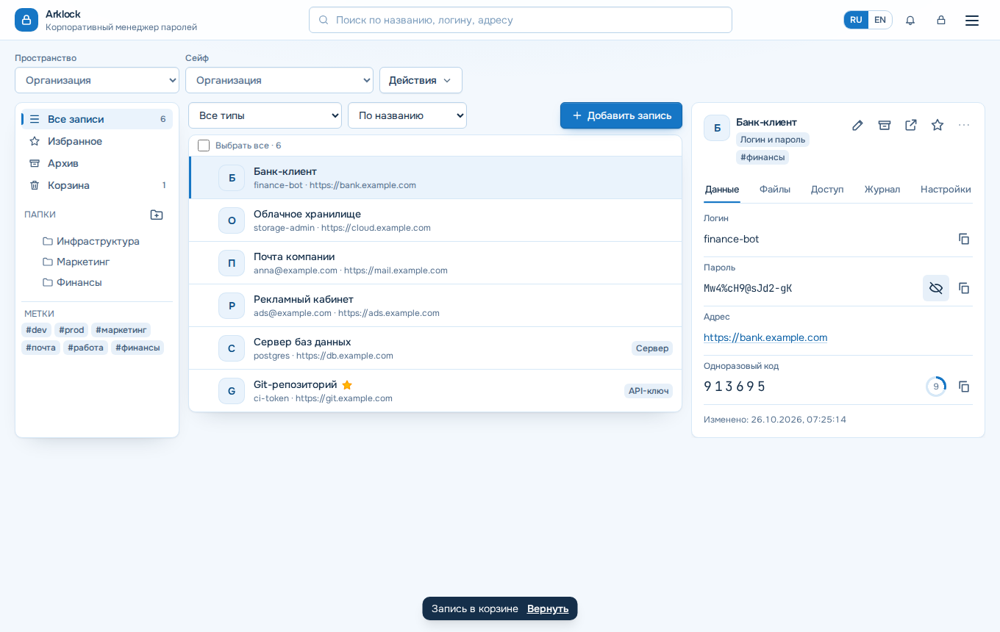

# Arklock

> Относится к версии 1.88.0 · проверено 2026-10-28 · уровень проверки 2

**Arklock — корпоративный менеджер паролей, который работает на вашем сервере.** Записи шифруются в браузере сотрудника, поэтому сервер хранит только шифртекст и не может прочитать пароли. Администратор выдаёт доступ людям и группам, подключает каталог пользователей и обслуживает систему из веб-панели. Продукт бесплатный и открытый (AGPL-3.0-only), без лицензионных ключей и телеметрии.



*Рабочее пространство: список записей слева, карточка записи справа. Данные вымышленные.*

## Подходит ли Arklock вам

Arklock рассчитан на организацию от нескольких человек до нескольких сотен, которой нужен собственный менеджер паролей. Подробности и случаи, когда он не подходит, — на странице [О продукте](О-продукте).

**Важно:** криптография Arklock не проходила независимый аудит. Прочитайте [Безопасность и приватность](Безопасность-и-приватность) до внедрения.

## С чего начать

| Вы | Ваш путь |
| --- | --- |
| Выбираете продукт | [О продукте](О-продукте) → [Состояние функций](Состояние-функций) → [Безопасность и приватность](Безопасность-и-приватность) |
| Сотрудник | [Первые шаги с Arklock](Первые-шаги-с-Arklock) → [Как работать с записями](Как-работать-с-записями) → [Как выбрать тему оформления](Как-выбрать-тему-оформления) |
| Системный администратор | [Системные требования](Системные-требования) → [Установка](Установка) → [Как настроить HTTPS](Как-настроить-HTTPS-и-reverse-proxy) → [Как настроить почту](Как-настроить-почту) → [Как сделать резервную копию](Как-сделать-резервную-копию-и-восстановить) |
| Администратор доступа | [Как выдать доступ сотрудникам](Как-выдать-доступ-сотрудникам) → [Как уволить сотрудника](Как-уволить-сотрудника) |
| Специалист по безопасности | [Безопасность и приватность](Безопасность-и-приватность) → [Как работает отзыв доступа](Как-работает-отзыв-доступа) → [Справочник: журнал событий](Справочник-журнал-событий) |
| Интегратор | [Как подключить LDAP или Active Directory](Как-подключить-LDAP-или-Active-Directory) → [Как настроить SSO](Как-настроить-SSO-OIDC-и-SAML) → [Справочник: API](Справочник-API) → [Как передавать журнал во внешние системы](Как-передавать-журнал-во-внешние-системы) |
| Разработчик | [Участие в разработке](Участие-в-разработке) → [Как устроен Arklock](Как-устроен-Arklock) |
| Сотрудник поддержки | [Диагностика](Диагностика) → [Частые вопросы](Частые-вопросы) |

## Что умеет Arklock

| Группа | Польза | Подробнее |
| --- | --- | --- |
| Записи и сейфы | Пароли, заметки, файлы, коды TOTP; папки, метки, избранное, корзина, история версий | [Как работать с записями](Как-работать-с-записями) |
| Доступ | Права по людям и группам на сейф, папку и запись, сроки, явный запрет | [Как выдать доступ сотрудникам](Как-выдать-доступ-сотрудникам), [Справочник: роли и права](Справочник-роли-и-права) |
| Вход | Локальные учётные записи, LDAP/Active Directory, OpenID Connect, SAML 2.0, второй фактор | [LDAP](Как-подключить-LDAP-или-Active-Directory), [SSO](Как-настроить-SSO-OIDC-и-SAML) |
| Увольнение | Одно действие закрывает доступ и показывает, какие пароли сменить | [Как уволить сотрудника](Как-уволить-сотрудника) |
| Эксплуатация | Установщик, обновление с откатом, зашифрованные копии, S3 и SMB | [Установка](Установка), [Обновление](Как-обновить-и-откатить), [Копии](Как-сделать-резервную-копию-и-восстановить) |
| Клиенты | Расширение Chromium и Firefox, PWA для телефона, командная строка, токены API | [Расширение и телефон](Как-пользоваться-расширением-и-телефоном), [Командная строка](Как-работать-из-командной-строки) |
| Перенос данных | Импорт из CSV, KeePass, Bitwarden, Passwork; зашифрованный экспорт (только главный администратор) | [Как импортировать и экспортировать](Как-импортировать-и-экспортировать-пароли) |

## Типовые сценарии

- **Отдел или компания меняет хранение паролей.** Импорт из файла, мастер «Подразделения», приглашение списком.
- **Сотрудник уходит.** Передача владения, блокировка, завершение сеансов и список паролей для смены.
- **Нужен контроль в SIEM.** Журнал действий уходит в syslog и подписанные вебхуки.

## Компоненты

- **Сервер** (Node.js, Fastify) проверяет права и хранит шифртекст в PostgreSQL.
- **Веб-клиент** (Vue 3) шифрует и расшифровывает записи в браузере.
- **Помощник обновлений** — служба systemd на сервере. Он выполняет обновление, откат и копии по запросу панели.
- **Расширение браузера и консольный клиент** используют те же функции шифрования.

Схема — в статье [Как устроен Arklock](Как-устроен-Arklock).

## Минимальный запуск

Нужен сервер с Ubuntu 22.04/24.04 или Debian 12, 1 ГБ памяти и root-доступ (не запускалось в среде автора вики; в CI проверена Ubuntu 24.04):

```bash
curl -fsSL https://github.com/calleograph/Arklock/releases/latest/download/install.sh | sudo bash
```

Установщик покажет адрес и одноразовый код настройки. Дальше — [Установка](Установка) и [Первые шаги с Arklock](Первые-шаги-с-Arklock).

## Статус

Версия 1.88.0. Продукт активно развивается; часть функций частично реализована или не проверена в реальной инфраструктуре. Честная таблица — [Состояние функций](Состояние-функций), планы — [Планы и известные ограничения](Планы-и-известные-ограничения).

## Ссылки

- [Репозиторий](https://github.com/calleograph/Arklock) · [последний выпуск](https://github.com/calleograph/Arklock/releases/latest)
- [Сообщить об ошибке или предложить функцию](https://github.com/calleograph/Arklock/issues)
- [Лицензия и политика безопасности](Лицензия-и-политика-безопасности) · [Участие в разработке](Участие-в-разработке)
