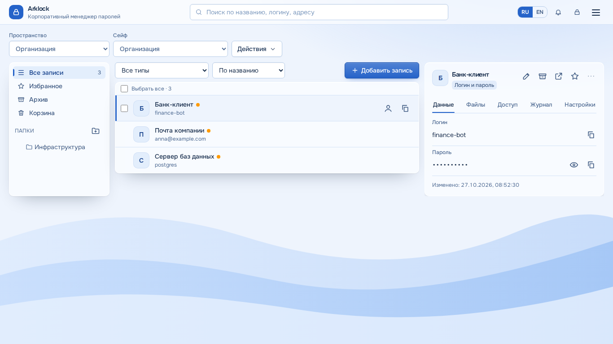
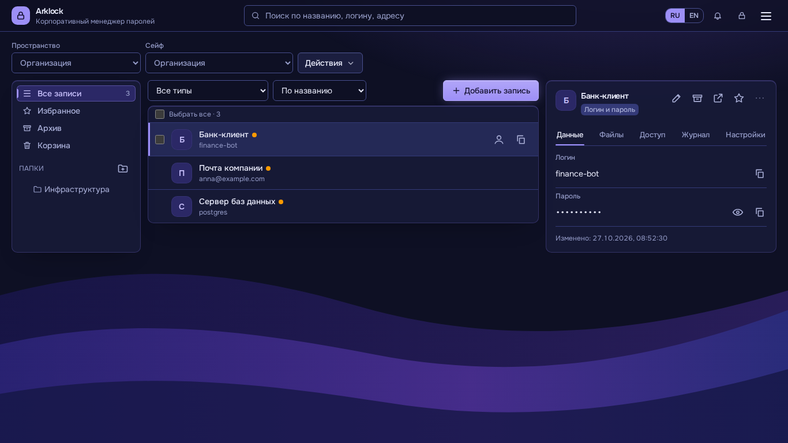
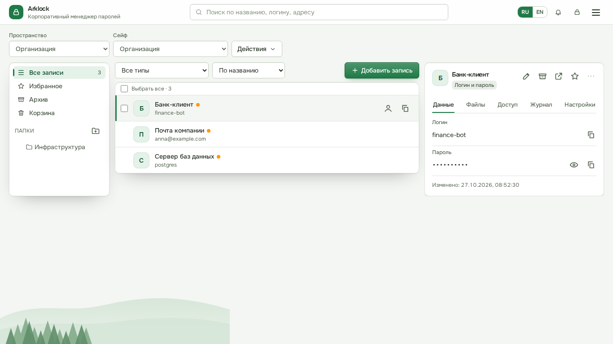
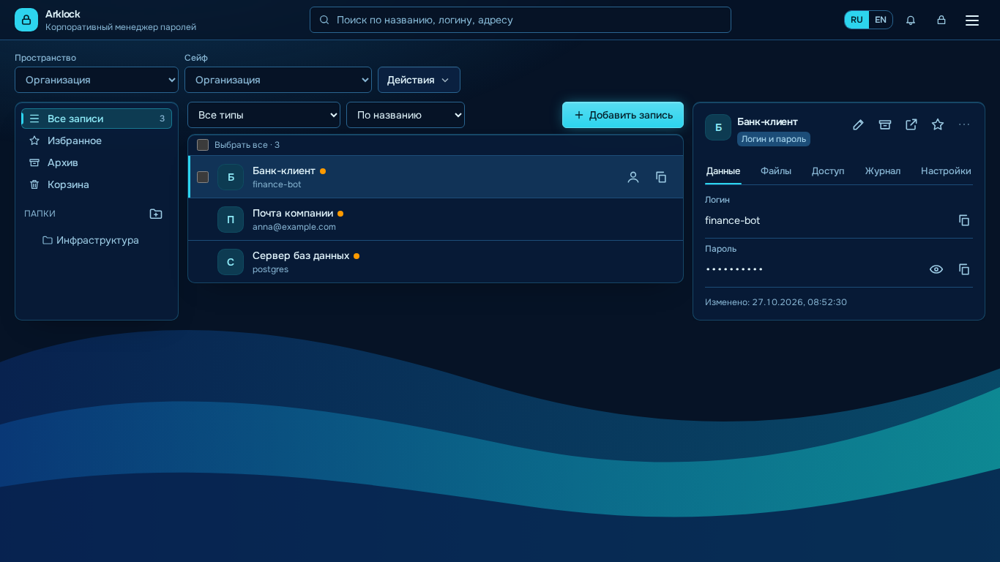

# Как выбрать тему оформления

> Относится к версии 1.78.0 · проверено 2026-10-27 · уровень проверки 2

*Тип страницы: руководство.*

**Задача:** сменить внешний вид Arklock для себя. Выбор личный: он хранится в вашем профиле, не меняет оформление у других сотрудников и сохраняется после выхода, перезагрузки страницы и входа с другого устройства.

## Как выбрать

1. Откройте меню в правом верхнем углу (значок «три полоски») и выберите **Настройки**.
2. В разделе **Внешний вид** нажмите карточку темы. Тема применяется сразу, перезагружать страницу не нужно. Выбранная карточка помечена «Выбрана».

## Какие темы есть

| Тема | Для кого и когда |
| --- | --- |
| Современный и лёгкий | Светлое голубое «стекло», мягкие синие акценты, волны на фоне. Для дневной работы |
| Тёмный профессиональный | Тёмно-синяя основа и фиолетовые акценты. Для работы вечером и при слабом освещении |
| Корпоративный минимализм | Нейтральная основа, зелёные акценты, строгие панели, внизу слева — лёгкий лес |
| Современный градиентный | Глубокий синий фон, бирюзовые акценты, градиентные волны |

Ниже «Прежние схемы»: корпоративная голубая, светлая, тёмная, тёмно-зелёная, изумрудная и закатная. Их выбор не потерян при обновлении.

## Тема по умолчанию для организации

Администратор может выбрать тему, которую увидят сотрудники, ещё не выбравшие свою: **Администрирование → Настройки сервера → Основные → Тема по умолчанию**. Личный выбор сотрудника эта настройка не перезаписывает.

## Если что-то не так

- Страница входа показывает последнюю тему, выбранную на этом устройстве; после входа применяется тема из профиля.
- Фоновые рисунки хранятся на вашем сервере (около 1 КБ на тему), внешних запросов нет. На экране телефона рисунок уменьшен, у «Корпоративного минимализма» — скрыт.

## Что дальше

- [Первые шаги с Arklock](Первые-шаги-с-Arklock)
- [Как работать с записями](Как-работать-с-записями)
