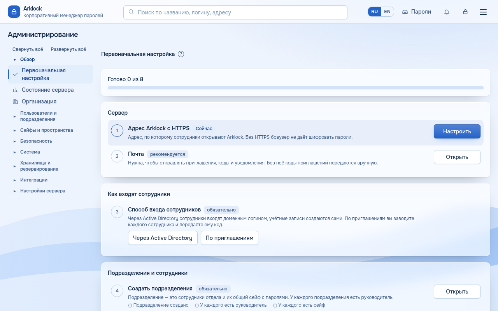
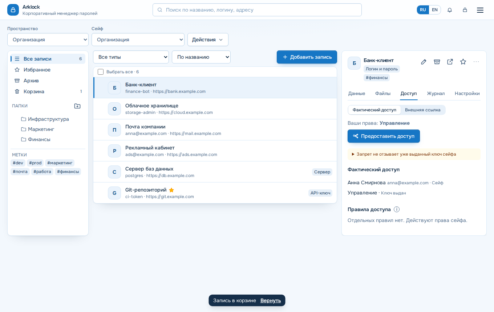

# Как выдать доступ сотрудникам

> Относится к версии 2.1.0 · проверено 2026-11-14 · уровень проверки 2

*Тип страницы: практическое руководство.*

Для кого: администратор. Результат: сотрудники созданы, входят в группы и видят нужные сейфы. Нужно заранее: учётная запись администратора ([Первые шаги](Первые-шаги-с-Arklock)). Роль администратора сама не открывает содержимое сейфов: нужны назначение и ключ.

*Администрирование: «Первоначальная настройка». Данные вымышленные.*

## Быстрый путь: отдел

Отдел в Arklock — это группа с ролью в сейфе отдела.

1. «Администрирование → Пользователи и группы → Группы» → «Создать группу»: название отдела и сотрудники.
2. Рабочая область → «Действия» → «Новый сейф».
3. «Действия» → «Настройки сейфа» → «Предоставить доступ»: группа и роль (обычно «Редактор»), руководителю отдела — «Администратор».

Шаг «Создать группы и открыть им сейфы» в «Обзор → Первоначальная настройка» ведёт туда же. Подробнее: [Группы, сейфы и доступ](Как-устроены-группы-сейфы-и-доступ).

## Пригласить сотрудников

1. Откройте «Администрирование → Пользователи и группы → Создание и приглашение».
2. Вставьте строки «Имя; почта; группа». Группа — это отдел, в который сотрудник попадёт после активации; она необязательна.
3. Проверьте предпросмотр. Ошибки блокируют создание.
4. Создайте приглашения. Вы получите коды активации и файл CSV.
5. Передайте каждому сотруднику его код отдельным каналом. Для одного сотрудника (форма «Новый пользователь») Arklock сразу показывает готовый текст приглашения: адрес Arklock, что нажать, учётную запись и код. Нажмите «Скопировать приглашение» и отправьте текст сотруднику.

Кнопка «Добавить сотрудника» есть и в списке «Пользователи»: она открывает эту же страницу.

Если настроен LDAP, SAML или OIDC, сотрудники входят через них ([LDAP](Как-подключить-LDAP-или-Active-Directory), [SSO](Как-настроить-SSO-OIDC-и-SAML)). Пароль разблокировки сейфов остаётся отдельным: его задаёт сам сотрудник при первом входе.

## Выдать доступ к сейфу

1. Добавьте сотрудников в группу («Администрирование → Пользователи и группы → Группы»). Для групп доступно массовое добавление; изменение применяется одной транзакцией.
2. Назначьте группе роль в настройках сейфа: читатель, редактор или администратор. Можно и наоборот: в окне группы, вкладка «Сейфы» → «Открыть сейф группе». Кто состоит в группе с ролью в сейфе, тот видит сейф; других условий нет.
3. Ключ сейфа новому участнику запечатывает браузер администратора сейфа сразу после того, как он добавил человека в группу или открыл сейф группе. Иначе — когда администратор сейфа в следующий раз откроет Arklock; до этого у сотрудника сейф отмечен ⏳. В режиме «Простой вход» ключ выдаёт сервер сразу.

Права и готовность ключа — разные состояния. Вкладка «Доступ» у записи показывает итоговое право, источник и готовность ключа.

*Вкладка «Доступ».*

## Правила объектов

- Права роли сейфа, групп, папок-предков и самой записи объединяются по наибольшему уровню.
- Явный запрет «Нет доступа» сильнее любого разрешения.
- Истёкшие назначения не учитываются.
- Для папок есть уровень «Структура»: видеть папку и создавать записи, не читая их.
- Запрет действует на сервере, но не изолирует запись криптографически от участника, у которого есть ключ сейфа. Для независимых границ доверия используйте разные сейфы ([Как работает отзыв доступа](Как-работает-отзыв-доступа)).

Подробнее: [Справочник: роли и права](Справочник-роли-и-права).

## Перевести сотрудника в другой отдел

Кнопка «Перевод» в карточке сотрудника. Перед изменением Arklock показывает, какой доступ сотрудник потеряет и какой получит. Новая группа добавляется до исключения из прежней; по потерянным записям открываются события «смените пароль».

## Срок действия учётной записи

Для подрядчиков задайте «Срок действия учётной записи» в карточке сотрудника. После срока запись отключается, сеансы и токены перестают действовать. Для администраторов и для самого себя срок не задаётся. Доступы к сейфам при истечении не меняются: если человек ушёл насовсем, выполните [увольнение](Как-уволить-сотрудника).

## Сохранность доступа

Для важных сейфов назначьте минимум двух хранителей ключа. Перед отключением последнего хранителя Arklock предупреждает. Рекомендуем также настроить [корпоративное восстановление](Как-настроить-корпоративное-восстановление).

## Типичные ошибки

- Сотрудник не видит сейф: [Диагностика](Диагностика).

## Что дальше

- [Как уволить сотрудника](Как-уволить-сотрудника)
- [Как настроить корпоративное восстановление](Как-настроить-корпоративное-восстановление)
