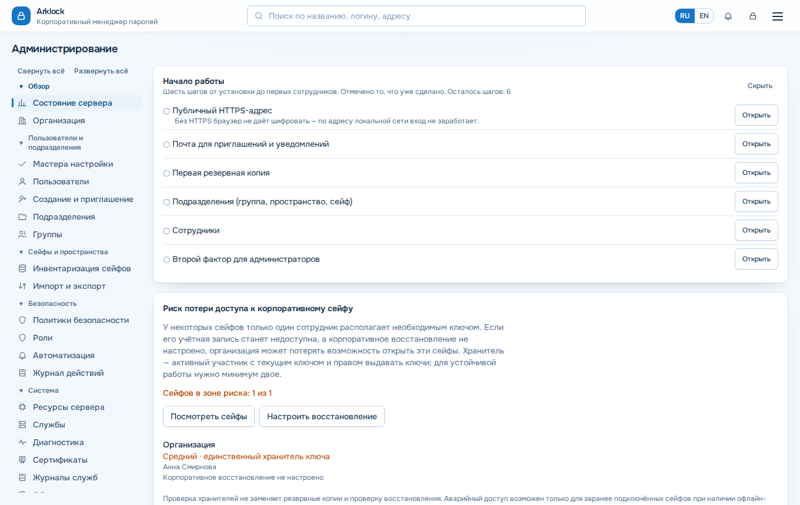
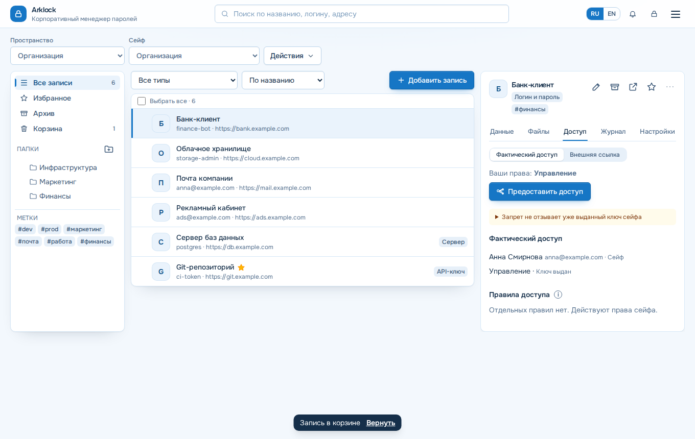

# Как выдать доступ сотрудникам

> Относится к версии 1.80.0 · проверено 2026-10-28 · уровень проверки 2

*Тип страницы: практическое руководство.*

Для кого: администратор. Результат: сотрудники созданы, входят в группы и видят нужные сейфы. Нужно заранее: учётная запись администратора ([Первые шаги](Первые-шаги-с-Arklock)). Роль администратора сама не открывает содержимое сейфов: нужны назначение и ключ.

*Администрирование: «Начало работы». Данные вымышленные.*

## Быстрый путь: подразделение

Мастер «Подразделения» («Администрирование → Пользователи и подразделения → Мастера настройки» или «Подразделения») создаёт за один проход группу, закрытое пространство, сейф отдела, отдельный сейф руководства и стартовые папки. Можно вставить список отделов. Предпросмотр показывает конфликты; пока они есть, создание заблокировано. Повтор безопасен: дублей не будет.

## Пригласить сотрудников

1. Откройте «Администрирование → Пользователи и подразделения → Создание и приглашение».
2. Вставьте строки «Имя; почта; отдел».
3. Проверьте предпросмотр. Ошибки блокируют создание.
4. Создайте приглашения. Вы получите коды активации и файл CSV.
5. Передайте каждому сотруднику его код отдельным каналом.

Если настроен LDAP, SAML или OIDC, сотрудники входят через них ([LDAP](Как-подключить-LDAP-или-Active-Directory), [SSO](Как-настроить-SSO-OIDC-и-SAML)). Пароль разблокировки сейфов остаётся отдельным: его задаёт сам сотрудник при первом входе.

## Выдать доступ к сейфу

1. Добавьте сотрудников в группу («Администрирование → Пользователи и подразделения → Группы»). Для групп доступно массовое добавление; изменение применяется одной транзакцией.
2. Назначьте группе роль в настройках сейфа: читатель, редактор или менеджер.
3. Дождитесь выдачи ключа: участник с правом управления и открытым ключом сейфа выдаёт подписанные ключи автоматически при загрузке сейфов. До этого у сотрудника статус «ожидает ключ».

Права и готовность ключа — разные состояния. Вкладка «Доступ» у записи показывает итоговое право, источник и готовность ключа.

*Вкладка «Доступ».*

## Правила объектов

- Права роли сейфа, групп, папок-предков и самой записи объединяются по наибольшему уровню.
- Явный запрет «Нет доступа» сильнее любого разрешения.
- Истёкшие назначения не учитываются.
- Для папок есть уровень «Структура»: видеть папку и создавать записи, не читая их.
- Запрет действует на сервере, но не изолирует запись криптографически от участника, у которого есть ключ сейфа. Для независимых границ доверия используйте разные сейфы ([Как работает отзыв доступа](Как-работает-отзыв-доступа)).

Подробнее: [Справочник: роли и права](Справочник-роли-и-права).

## Перевести сотрудника в другое подразделение

Перед изменением Arklock показывает, какой доступ сотрудник потеряет и какой получит. Новая группа добавляется до исключения из прежней; по потерянным записям открываются события «смените пароль».

## Срок действия учётной записи

Для подрядчиков задайте «Срок действия учётной записи» в карточке сотрудника. После срока запись отключается, сеансы и токены перестают действовать. Для администраторов и для самого себя срок не задаётся. Доступы к сейфам при истечении не меняются: если человек ушёл насовсем, выполните [увольнение](Как-уволить-сотрудника).

## Сохранность доступа

Для важных сейфов назначьте минимум двух хранителей ключа. Перед отключением последнего хранителя Arklock предупреждает. Рекомендуем также настроить [корпоративное восстановление](Как-настроить-корпоративное-восстановление).

## Типичные ошибки

- Сотрудник не видит сейф: [Диагностика](Диагностика).

## Что дальше

- [Как уволить сотрудника](Как-уволить-сотрудника)
- [Как настроить корпоративное восстановление](Как-настроить-корпоративное-восстановление)
