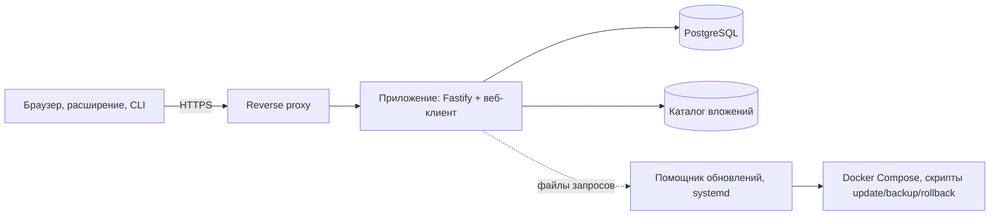

# Как устроен Arklock

> Относится к версии 1.86.0 · проверено 2026-10-28 · уровень проверки 1 (чтение кода и `compose.yaml`)

*Тип страницы: объяснение.*

## Компоненты

Arklock — модульный монолит: один процесс API, веб-клиент и PostgreSQL. Рядом на сервере работает помощник обновлений.

- **Приложение** (Node.js 24, TypeScript, Fastify, Drizzle): проверяет права и сеансы, хранит шифртекст, применяет миграции при старте. Подсистемы в `apps/api/src`: учётные записи, доступ, сейфы, журнал и события безопасности, администрирование, интеграции, обновления, резервные копии, фоновые задачи.
- **Веб-клиент** (Vue 3, Pinia, Tailwind): шифрует и расшифровывает записи, ищет по ним, импортирует и экспортирует.
- **Общие пакеты**: `@arklock/crypto` (шифрование, без зависимостей от сервера и интерфейса) и `@arklock/contracts` (схемы запросов Zod).
- **База**: PostgreSQL 16 в отдельном контейнере во внутренней сети. Для разработки и тестов есть встроенная БД PGlite.
- **Вложения**: зашифрованные файлы в каталоге `DATA_ROOT/blobs`.
- **Помощник обновлений**: служба systemd. Приложение не имеет доступа к Docker и оболочке: оно кладёт запрос в каталог обмена, а помощник выполняет только разрешённые операции (`check`, `update vX.Y.Z`, `rollback`) с проверкой значений по шаблонам и запуском в стерильном окружении.
- **Клиенты**: расширение браузера (Manifest V3), PWA, консольный клиент `arklock`. Все используют одни и те же функции шифрования.

Контейнер приложения: не root, файловая система только для чтения, `cap_drop: ALL`, `no-new-privileges`; порт по умолчанию привязан к `127.0.0.1`.

## Почему так

| Решение | Причина | Компромисс |
| --- | --- | --- |
| Шифрование в браузере | Сервер, администратор сервера и дамп базы не раскрывают записи | Поиск и проверка паролей выполняются на клиенте; сервер не может проверить сложность пароля от стороннего клиента |
| Пароль разблокировки сейфов отдельно от пароля каталога | Внешний вход подтверждает личность, но не даёт ключей | Сотрудник помнит два пароля |
| Один ключ на сейф, ключ записи обёрнут им | Простая выдача и отзыв доступа | Запрет на запись не изолирует её криптографически внутри сейфа |
| Помощник обновлений вне приложения | Приложение не получает прав над Docker | Без работающего помощника обновлений и плановых копий из панели нет |
| Монолит с PostgreSQL | Простая эксплуатация для организации до нескольких сотен человек | Горизонтальное масштабирование не заявляется; таймеры работают в каждом процессе |
| Нет скрытого серверного мастер-ключа | Администратор не может «заглянуть» в данные | Потеря паролей и ключей восстановления означает потерю данных |

## Масштаб и нагрузка

Проверено: поиск и списки на 30 000 сотрудников (0,3 с на поиск), сейф на 1500 записей, 20 подразделений и 60+ сотрудников в учебной организации. Нагрузочные характеристики одновременной работы сотен пользователей не измерялись. Планировщики (проверка обновлений, сверка LDAP, метрики) работают в каждом процессе: несколько экземпляров приложения не рассчитаны без общей блокировки.

## Что дальше

- [Безопасность и приватность](Безопасность-и-приватность)
- [Участие в разработке](Участие-в-разработке)
