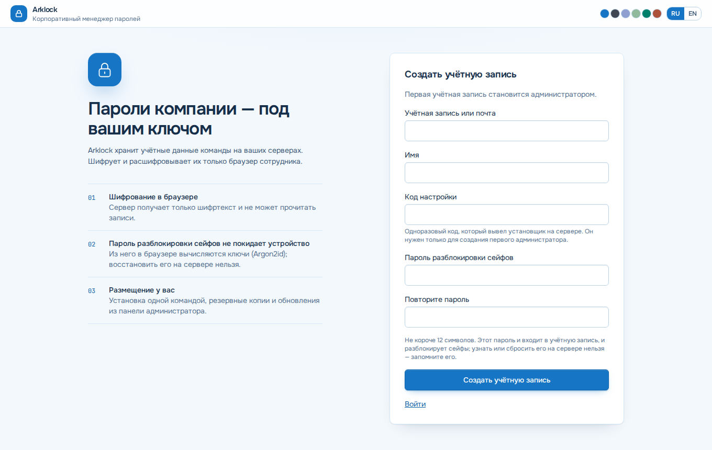

# Первые шаги с Arklock

> Относится к версии 1.86.0 · проверено 2026-10-28 · уровень проверки 2 (сценарии регистрации и записей покрыты браузерными тестами; пошаговый текст автором на чистом сервере не выполнялся)

*Тип страницы: учебник.*

**Чему вы научитесь:** создать первую учётную запись администратора, сохранить ключ восстановления, добавить запись и открыть её. **Время:** около 10 минут. **Что понадобится:** установленный Arklock ([Установка](Установка)), адрес с HTTPS или `localhost`, одноразовый код настройки.

## Шаги

1. Откройте адрес из итога установки: HTTPS-адрес организации либо `http://localhost:<порт>` (на самом сервере или через SSH-туннель; команда напечатана в итоге, а `scripts/access.sh status` повторит её). По обычному `http://<IP>` браузер шифровать не станет, и страница входа скажет об этом и подскажет безопасный адрес. Вы видите форму «Создать учётную запись».

   

   *Экран первой регистрации. Данные полей пусты.*

2. Введите учётную запись или почту и имя.
3. Введите **код настройки**. Установщик показал его в конце установки; он же лежит в `/etc/arklock/arklock.env` в строке `BOOTSTRAP_TOKEN=`.
4. Придумайте **пароль разблокировки сейфов**, не короче 12 символов, и повторите его.
5. Нажмите «Создать учётную запись». Вы видите **ключ восстановления**.

> **Предупреждение.** Сохраните ключ восстановления сразу, вне Arklock. Пароль разблокировки сейфов и ключ восстановления сервер не знает. Если потеряны оба, данные не открыть, и администратор не поможет ([Частые вопросы](Частые-вопросы)).

6. Отметьте «Я сохранил ключ восстановления» и нажмите «Продолжить». Ключ больше показан не будет. Вы входите в рабочее пространство. Первая учётная запись становится главным администратором, и ей создан корпоративный сейф «Организация».
7. Нажмите «Добавить запись», выберите тип «Логин и пароль», заполните название, логин и пароль (можно нажать «Сгенерировать») и сохраните. Запись появилась в списке.
8. Выберите запись в списке. В карточке справа видны вкладки «Данные», «Файлы», «Доступ», «Журнал», «Настройки». Нажмите значок «глаз» у пароля, чтобы показать его, и значок копирования, чтобы скопировать.

Что получилось: у вас есть учётная запись администратора и первая зашифрованная запись. Сервер хранит её только шифртекстом.

## Что дальше

- [Как работать с записями](Как-работать-с-записями)
- [Как выдать доступ сотрудникам](Как-выдать-доступ-сотрудникам)
- [Как настроить HTTPS](Как-настроить-HTTPS-и-reverse-proxy) — если вы открыли Arklock не через `localhost`
